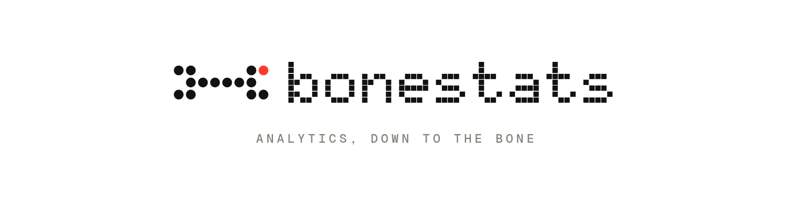
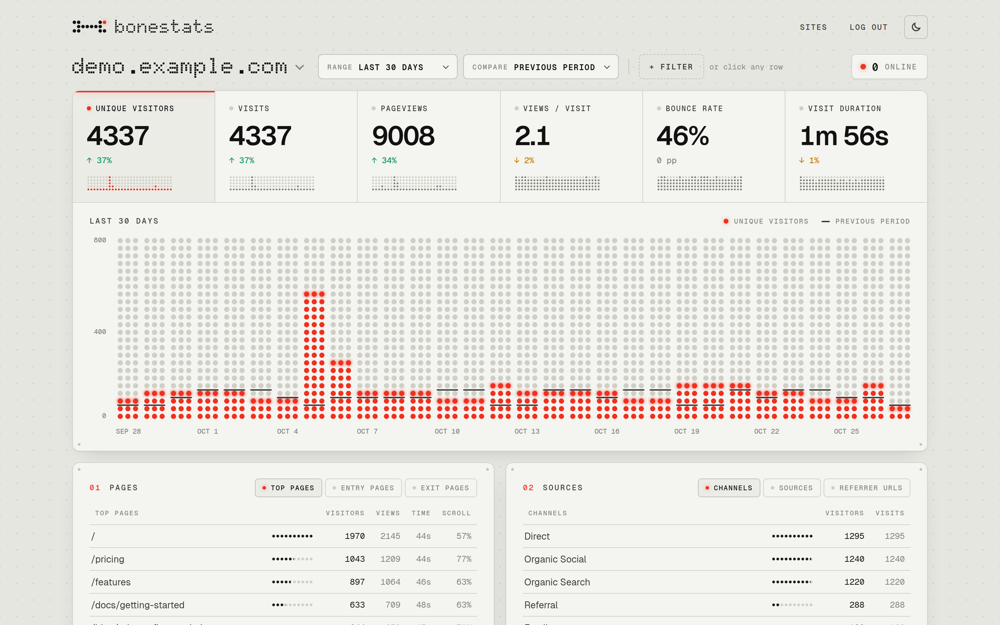
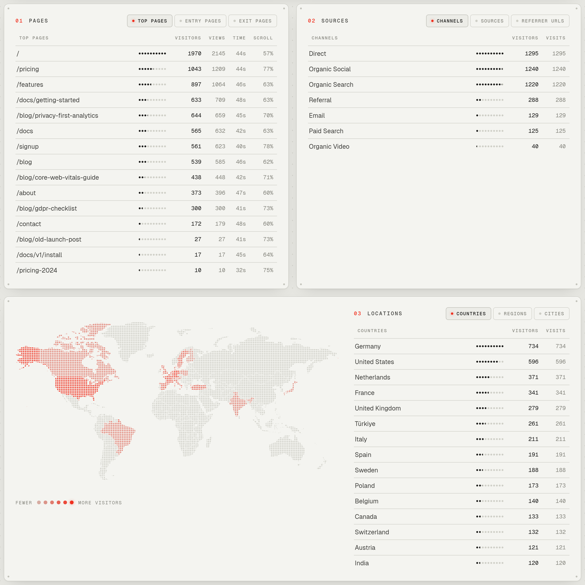
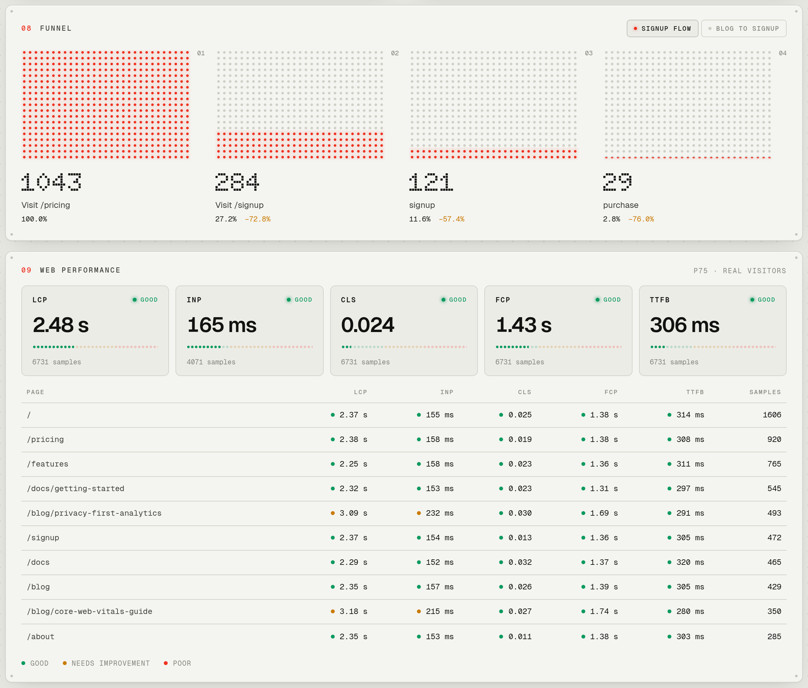

<p align="center">
  <picture>
    <source media="(prefers-color-scheme: dark)" srcset="docs/logo-dark.png">
    
  </picture>
</p>

<p align="center">
  A tiny, cookieless, self-hosted web analytics server.<br>
  One Go binary, one SQLite file, a 1.2 KB tracking script.
</p>



bonestats runs as a single Go binary with one SQLite file. Its tracking script is about 1.2 KB gzipped, smaller than Plausible's, and also measures Core Web Vitals, scroll depth and time on page. The dashboard looks like an instrument panel: dot-matrix display type, LED-style meters and a single signal-red accent, in a light and a dark theme.

## Install with Docker

On a server with Docker, a domain pointing at it, and ports 80 and 443 open:

```sh
mkdir bonestats && cd bonestats
curl -fsSLO https://raw.githubusercontent.com/yi00it/bonestats/master/docker-compose.yml
curl -fsSL -o .env https://raw.githubusercontent.com/yi00it/bonestats/master/.env.example
nano .env                                 # set BONESTATS_DOMAIN and BONESTATS_PASSWORD
docker compose up -d
```

This runs bonestats behind [Caddy](https://caddyserver.com), which gets an HTTPS certificate automatically, so open `https://<your domain>` and log in. The image (`ghcr.io/yi00it/bonestats`, amd64 and arm64) includes the DB-IP Lite country database, and the data lives in the `bonestats-data` volume. To update: `docker compose pull && docker compose up -d`. To back up (keep backups private, see below):

```sh
docker compose stop bonestats && docker compose cp bonestats:/data/bonestats.db ./bonestats-backup.db && docker compose start bonestats
```

Already running a reverse proxy? Run only the image and point your proxy at it (see [Production deployment](#production-deployment)):

```sh
docker run -d --name bonestats --restart unless-stopped -p 127.0.0.1:8080:8080 \
  -e BONESTATS_PASSWORD='choose-a-long-password' -e BONESTATS_PROXY_HEADER=X-Forwarded-For \
  -v bonestats-data:/data ghcr.io/yi00it/bonestats
```

Prebuilt binaries for Linux, macOS, Windows and FreeBSD are on the [releases page](https://github.com/yi00it/bonestats/releases).

## Build from source

```sh
make geoip                                # optional: countries (DB-IP Lite, 8 MB)
make geoip-city                           # optional: + regions and cities (130 MB)
make build
BONESTATS_PASSWORD='choose-a-long-password' make run
```

Open http://localhost:8080, log in, add your site (use `localhost` for local testing) and paste the snippet into your pages' `<head>`:

```html
<script defer data-domain="example.com" src="https://stats.example.com/bs.js"></script>
```

Custom events, with optional properties and revenue: `bonestats("purchase", {plan: "pro"}, 29.90)`. To queue events before the script loads, add
`<script>window.bonestats=window.bonestats||function(){(bonestats.q=bonestats.q||[]).push(arguments)}</script>`.

## Dashboard



- **Metrics:** unique visitors, visits, pageviews, views per visit, bounce rate and visit duration. Each is compared with the previous period or the previous year, and you can click any of them to chart it.
- **Date ranges:** today, yesterday, 7/28/30/91 days, month to date, last month, year to date, 12 months, all time and custom.
- **Filters:** click any row (a page, source, country, browser…) to filter the whole dashboard, or use **+ Filter** for "is", "is not" and "contains". Filters live in the URL, so every view can be bookmarked.
- **Pages:** top pages (with time on page and scroll depth), entry pages and exit pages.
- **Sources:** channels (Organic Search, Social, Email, Paid…), source domains, referrer URLs (host and path, never the query string), and UTM source, medium, campaign, term and content.
- **Locations:** world map, countries, regions and cities.
- **Devices:** browser, browser version, OS, OS version, device type and screen size (all major versions and size ranges only).
- **Goals** (set them up on Sites → Goals & funnels): custom event goals, pageview goals with `*` wildcards, conversion rate and revenue. With a goal filter on, every breakdown shows a CR column.
- **Properties** of custom events, broken down by value (and revenue).
- **Funnels:** 2 to 8 goals that visitors must complete in order within one visit, with the drop-off at each step.
- **Web performance:** the 75th percentile of LCP, INP, CLS, FCP and TTFB from real visitors, rated good, needs improvement or poor, overall and per page.
- **Live:** the dashboard refreshes every 15 seconds while it's open and shows how many visitors are online. Numbers that changed flicker to their new value; open tabs and your scroll position are kept.
- **Light and dark:** follows your system setting, or pick one with the switch in the header (remembered in your browser).



Add-ons are opt-in via the script name: `bs.outbound.js` tracks clicks to other sites, `bs.downloads.js` tracks file downloads, and `bs.downloads.outbound.js` does both.

## Demo data

`make demo` (or `./bonestats demo -replace`) adds a site called `demo.example.com` with 90 days of realistic fake traffic, plus goals and funnels, so you can explore the dashboard before connecting a real site. Options: `-site`, `-days`, `-visitors` (average per day), `-db`, and `-replace` (recreate the site if it already exists). To remove the data, delete the site on the Sites page.

## Configuration

| Env var / flag | Default | |
|---|---|---|
| `BONESTATS_PASSWORD` | (required) | Admin password, at least 12 characters. Changing it logs out every session. After 10 wrong attempts from one IP (or 100 from all IPs together), logins are blocked for 15 minutes. |
| `BONESTATS_PASSWORD_FILE` / `-password-file` | (off) | Read the password from this file instead (e.g. a Docker or systemd secret). |
| `BONESTATS_ADDR` / `-addr` | `:8080` | Listen address |
| `BONESTATS_DB` / `-db` | `bonestats.db` | SQLite file |
| `BONESTATS_GEOIP` / `-geoip` | (off) | Path to a country `.mmdb` (DB-IP Lite or MaxMind) |
| `BONESTATS_RETENTION_DAYS` / `-retention` | `365` | Delete data older than N days (`0` = keep forever) |
| `BONESTATS_TZ` / `-tz` | `Local` | Timezone for dashboard days, e.g. `Europe/Berlin` |
| `BONESTATS_PROXY_HEADER` / `-proxy-header` | (off) | Behind a reverse proxy: the header it sets to the client's IP, e.g. `X-Forwarded-For` (the last entry is used, the one the proxy appended) or `X-Real-IP`. Only that header is read. See [Production deployment](#production-deployment). |
| `BONESTATS_TRUST_PROXY` / `-trust-proxy` | `false` | Deprecated, same as `BONESTATS_PROXY_HEADER=X-Forwarded-For`. |
| `BONESTATS_ALLOW_HTTP` / `-allow-http` | `false` | Allow logging in over plain HTTP from hosts other than `localhost`. Only for a trusted private network: the password and login cookie are sent unencrypted. |
| `BONESTATS_EVENT_RATE` / `-event-rate` | `120` | Beacons per minute accepted from one IP (IPv6: one /64), with bursts of the same size. More are dropped, so one client can't flood the database. `0` = unlimited. |
| `BONESTATS_SOURCE_URL` / `-source-url` | `https://github.com/yi00it/bonestats` | Linked as "Source code" in the dashboard footer. If you run a modified version, point it at your source: the AGPL asks you to offer it to your users. |

## Production deployment

bonestats speaks plain HTTP. On the internet, put it behind a reverse proxy that terminates HTTPS, and tell bonestats which header carries the client's IP. Without that, every visitor seems to come from the proxy: visitors are miscounted and anyone can lock you out of the login for 15 minutes (bonestats logs a warning when it notices this).

Caddy (sets `X-Forwarded-For` and `X-Forwarded-Proto` by default):

```
stats.example.com {
	reverse_proxy 127.0.0.1:8080
}
```

nginx, overwriting whatever the client sent:

```nginx
location / {
    proxy_pass http://127.0.0.1:8080;
    proxy_set_header Host $host;
    proxy_set_header X-Real-IP $remote_addr;
    proxy_set_header X-Forwarded-Proto $scheme;
}
```

Then start bonestats with `BONESTATS_PROXY_HEADER=X-Forwarded-For` (Caddy) or `BONESTATS_PROXY_HEADER=X-Real-IP` (nginx above), and `BONESTATS_ADDR=127.0.0.1:8080` so it can't be reached around the proxy. Name only a header your proxy always overwrites: any other header comes straight from the client and can be forged. With a chain of proxies, e.g. a CDN in front of nginx, make the last one set the real client IP.

The admin login only works over HTTPS (or on `localhost`), and the cookie is then `__Host-` prefixed and `Secure`. The database file is created readable by its owner only; keep it that way and keep backups private too, as it holds the current day's salt.

## What is collected

Per visit: referrer host and path (no query string), channel, UTM source/medium/campaign/term/content, browser and OS family plus major version, device class and screen-size range (from viewport width), country/region/city, and a visitor hash.
Per pageview: path (no query string), scroll depth and visible time. Path segments that look like personal data or secrets are replaced before storing: email addresses become `[email]`, and UUIDs, long hex IDs and mixed-case tokens (as in `/reset/<token>`) become `[id]`, in page paths and referrer paths alike. This is a best-effort guard, so still avoid personal data in your URLs.
Per custom event: name, up to 10 short properties, and an optional revenue amount.
Per page load: Core Web Vitals (LCP, INP, CLS, FCP, TTFB). Visit duration and bounce rate come from a 30-minute session window.

## Privacy design

- **No cookies or storage** on visitors' devices, and no fingerprinting.
- **IP addresses are never stored.** They are used in memory for the country lookup (done locally, nothing leaves the server) and for the visitor hash.
- Visitor hash = `sha256(daily_salt + domain + IP + User-Agent)`. The salt is random and **deleted within minutes after midnight** (in `BONESTATS_TZ`), overwritten on disk, so hashes can't be reversed or linked across days. As a result, someone who returns on another day counts as a new visitor. While a day's salt exists, someone holding the database could try to brute-force that day's hashes back to IP addresses, which is why the file is private.
- **Global Privacy Control and Do Not Track are honored** in the script and again on the server.
- Bots and automated browsers are filtered out.
- Old data is deleted automatically (see retention).

This is the same approach as Plausible and Fathom, which commonly run without a consent banner under GDPR/ePrivacy. It isn't legal advice: mention the analytics in your privacy policy, and check with a lawyer for your situation. Host the server in the EU to avoid transfer questions.

The DB-IP Lite data is licensed CC BY 4.0. The dashboard shows the required attribution when GeoIP is enabled.

## The tracking script

`internal/web/static/bs.js` is hand-minified to keep it tiny (about 1.9 KB raw, 1.2 KB gzipped). The add-ons in `static/ext/` are appended to it when requested by file name. The server builds and gzips every combination at startup and serves them with an ETag. Here's what the script does:

1. Stops immediately (and makes `bonestats()` do nothing) if the visitor sends GPC or DNT, or if it's an automated browser.
2. Sends a `pageview` beacon on load and on SPA navigations (`history.pushState`, `popstate`). The external referrer is only sent with the first one.
3. `bonestats(name, props, revenue)` sends a custom event, and calls queued before the script loaded are replayed.
4. It tracks the deepest scroll position and the time the page was visible.
5. It watches LCP, FCP, CLS (session windows), INP (about the 98th percentile of interactions) and TTFB with `PerformanceObserver`.
6. When the page is hidden, or before an SPA navigation, it sends a `leave` beacon with the page's scroll depth and visible time. This also extends the visit duration. The first one also carries the vitals.

Beacon fields: `d` domain, `n` name, `p` path, `w` viewport width, `r` referrer, `source`/`medium`/`campaign`/`term`/`content` UTM tags, `pr` properties, `rv` revenue, `sd` scroll depth, `et` visible ms, `v` vitals. Beacons are sent with `navigator.sendBeacon` as plain text, which avoids CORS preflight requests.

## Layout

```
main.go                    config, startup, retention job
internal/store             SQLite schema and migrations, writes, filters, dashboard queries, channels
internal/collect           /api/event: validation, hashing, UA parsing, GeoIP
internal/web               dashboard, goals pages, login, templates, static files (bs.js + add-ons, jsvectormap, fonts)
internal/demo              demo data generator
docs                       README images
```

## License

bonestats is Copyright (c) 2026 yi00it and released under the [GNU Affero General Public License v3.0](LICENSE) (AGPL-3.0-only). You can use, modify and self-host it freely; if you run a modified version as a network service, you must make your modified source available to its users. Versions released before the switch to AGPL remain available under the MIT License. To contribute, see [CONTRIBUTING.md](CONTRIBUTING.md). The bundled [jsvectormap](https://github.com/themustafaomar/jsvectormap) (including its world map) is MIT-licensed too; its license is in `internal/web/static/LICENSE.jsvectormap.txt`. The bundled [Geist](https://github.com/vercel/geist-font) and [Doto](https://github.com/oliverlalan/Doto) fonts are under the SIL Open Font License 1.1 (`internal/web/static/fonts/OFL-*.txt`). The DB-IP Lite data you download is CC BY 4.0.
